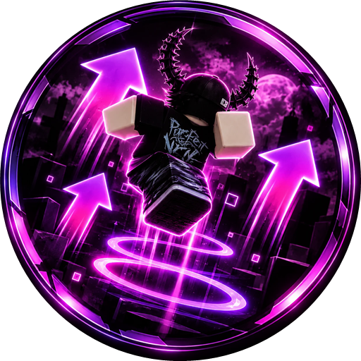

  

<h1 align="center">AFK Jumper</h1>

  <b>Made by Sufenue</b> 
  Keeps you from getting idle-kicked in Roblox, and puts you straight back in the game if you get disconnected anyway.

  <a href="https://github.com/SufenueS1/afk-jumper/releases/latest"><b>Download AFK-Jumper-Setup.exe</b></a>

## Download

Grab **AFK-Jumper-Setup.exe** from the [latest release](https://github.com/SufenueS1/afk-jumper/releases/latest) and run it. No admin rights needed — it installs just for your Windows account and adds a Start-menu shortcut.

> **"Windows protected your PC"?** The installer isn't code-signed yet, so SmartScreen warns about it. Click **More info → Run anyway**.

**Needs:** Windows 10 or 11 and the normal Roblox desktop app (Bloxstrap / Fishstrap work too). Nothing else to install.

## What it does

- **Anti-AFK jumper** — taps Space in Roblox every few seconds (you pick the interval, with a little randomness). If you're in another window it flips to Roblox for a split second and back. **F8** starts/stops it from anywhere, even in-game.
- **Auto-rejoin** — reads Roblox's own log files to notice when you're kicked, lose connection, or the server shuts down, waits for your internet if it dropped, then relaunches the game. It rejoins either your **most recent game** or **one you choose** (paste any game link). Leaving a game yourself never triggers it.
- **Auto-update** — checks this page's releases every few hours, downloads the new version in the background, verifies it against `SHA256SUMS.txt`, and uses it the next time you open the app (or right away with **Restart to update**).

## Good to know

- It doesn't modify or inject anything into Roblox — it only sends a normal key press and launches games through Roblox's own `roblox://` links.
- Some games have their own AFK rules; use it where AFK is allowed.
- The only network calls are Roblox's public APIs (game names and icons) and GitHub (update checks). No accounts, no tracking.
- Settings and game history live in `%APPDATA%\RobloxAfkJumper`.
- Uninstall from **Settings → Apps → AFK Jumper**.

Made by Sufenue. Not affiliated with or endorsed by Roblox Corporation.
